# Executive summary {.nobreak}

::: summary
**What we did.** Nine sensors measured temperature and humidity every 20 minutes for almost two
years inside, under and above the church and outside. We checked and cleaned the data, assessed
the **risk of mold** at every measured place with the scientific method of the Fraunhofer
Institute for Building Physics (moisture, temperature, surface temperature and – above all –
*how long* critical conditions last), and analysed how fast the **temperature at the organ** changes.

**Main findings**

1. **The basement storage area is the place most at risk.** It was at high mold risk during
   {{share_high.Basement|pct}} of the measured time and during {{season_share_high.summer.Basement|pct}}
   of the summer, with uninterrupted high-risk spells of up to {{longest_high_days.Basement|f1}} days.
2. **The art objects in the north-west corner (lower level)** are almost as exposed:
   {{share_high.Art objects NW|pct}} of the time at high risk, mostly from May to November.
3. **The north-facing exterior wall** is clearly riskier than the south and east walls: over the
   same periods it was at high risk about three times as often as the south wall
   ({{plaus_north_high|pct}} vs {{plaus_south_high|pct}}).
4. **The whole nave becomes critical in October and November** (organ {{season_share_high.autumn.Organ|pct}},
   art objects at the south wall {{season_share_high.autumn.Art objects S|pct}} of the time), when the
   outside air is still humid but the building has cooled down. **Winter and spring are calm.**
5. **The organ** warmed up too fast (more than 1 °C within one hour) on **{{organ_episodes}} occasions**,
   all of them when the heating was started in the heating season. Most happened on **Fridays and
   Saturdays** – not on Sunday mornings – including a regular Friday 9 a.m. pattern in early 2025.
6. **Several sensors were out of order for long periods.** For the north wall there are data for only
   {{availability.AWn|pct}} of the time, and **no wall was measured in winter 2024/25**.

**Top priorities**

| | What | Where | When |
|-|--------------|--------|--------|
| 1 | Dehumidify and stop summer ventilation | Basement storage area | May – October |
| 2 | Move art objects away from the wall, inspect their backs | North-west corner, north wall | now, then every September |
| 3 | Start the heating earlier and ramp it gently (max. 0.5 °C per hour) | Whole church, organ | every heating start, Oct – Apr |
| 4 | Ventilate only when the outside air is drier than inside | Nave, basement | all year, mainly at night in summer |
| 5 | Repair the wall sensors and add automatic alerts | Walls, art objects, organ | before the next heating season |
:::

Contents: 1 What was measured · 2 Where is the risk highest? · 3 When is the risk high? ·
4 The organ · 5 Recommendations · 6 What the data cannot tell us · Technical appendix A–H

# 1 · What was measured

Sensors recorded the air temperature and the relative humidity at nine places; five of them also
measured the temperature of the nearby surface (wall, organ case, art objects), which is decisive
for mold. Absolute humidity and dew point are calculated from these values.

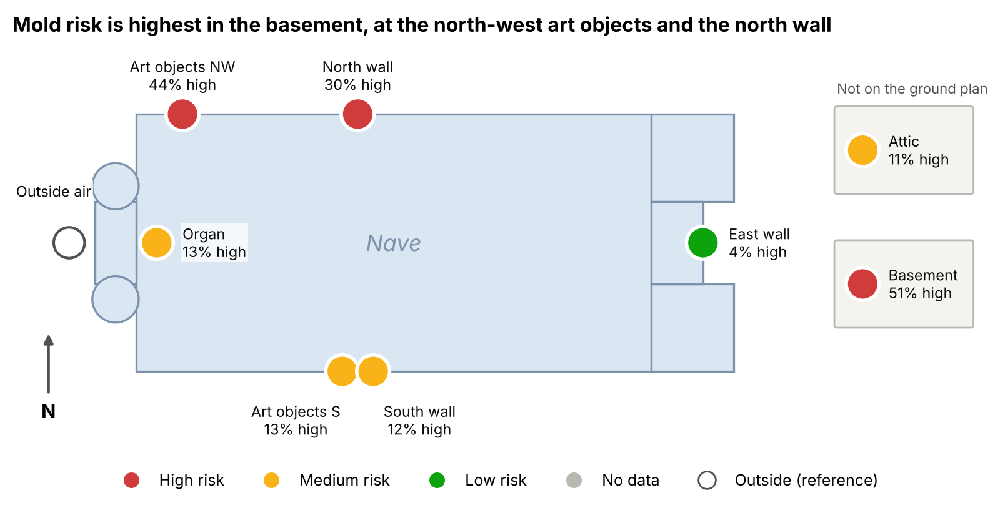{width=92%}

**How we judged mold risk.** Mold spores are everywhere; they germinate when a surface stays humid
long enough. How humid is "too humid" depends on the temperature: research by the Fraunhofer
Institute gives a limit curve (the *lowest isopleth for mold*): about 87 % relative humidity at 5 °C,
81.5 % at 10 °C and 77 % at 20 °C for dusty or dirty surfaces. We classified every 20-minute
measurement as

* high risk – water condenses on the surface, **or** the humidity is above
  the limit now *and* was above it for at least half of the last seven days;
* medium risk – the humidity is above the limit, or the surface is less
  than 3 °C warmer than the dew point (close to condensation);
* low risk – otherwise.

Times without data are never counted as safe. The method is deliberately cautious: it shows risk
*before* mold would become visible. It is meant for **comparing places and periods and setting
priorities**, not for predicting exactly where mold will grow.

# 2 · Where is the mold risk highest?

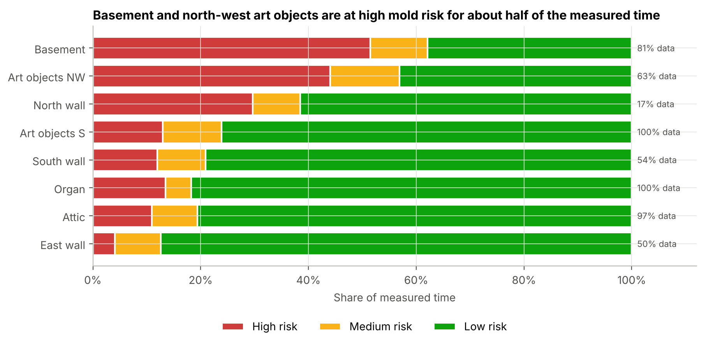{width=95%}

{{table:client_risk_table|pct=Time at high risk,Time at medium or high risk,Data available}}

Order of the table: fair comparison of each pair of places over the *same* periods (see
appendix E). Shares refer to the time the sensor was working. Classes: red = high risk at least 25 % of
the measured time, yellow = 10–25 %, green = below 10 %.

**What this means**

* **Basement storage area:** humid almost all summer and autumn. Stored objects (textiles,
  paper, wood, vestments) are at real risk.
* **Art objects in the north-west corner:** a cold corner of the lower level; humidity at the object
  surface was above the limit during more than half of the measured time and close to the dew point
  for about {{margin_critical_share.Art objects NW|pct}} of it.
* **North-facing exterior wall:** no sun, colder surface relative to the room, more often close to
  condensation than the south and east walls. The data cover only a few months, so this location
  may be underestimated.
* **Organ, art objects at the south wall, south wall, attic:** medium – unproblematic most of the
  year, but critical for weeks in October and November.
* **East wall:** lowest risk of all measured places.

The order of the places stays the same when we change the uncertain limits (stricter or looser
humidity limit, 2 °C or 4 °C distance from the dew point, shorter or longer persistence): the
basement and the north-west art objects are always the two riskiest places and the east wall is
always among the least risky.

# 3 · When is the risk high?

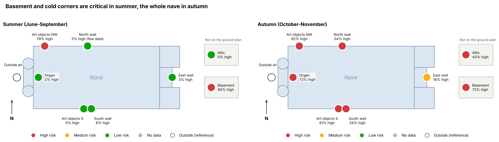{width=100%}

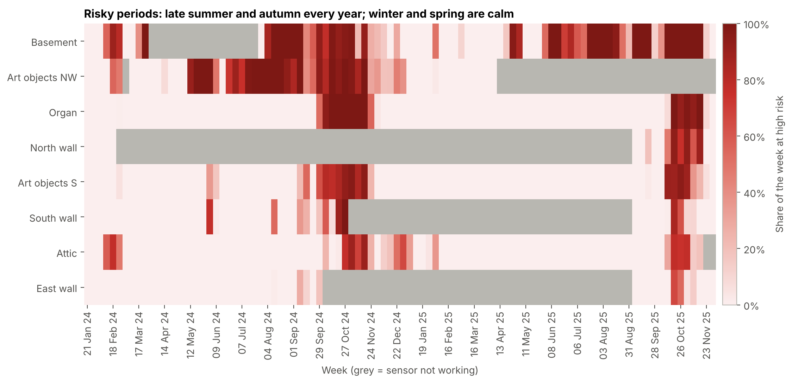{width=100%}

* **Summer (June–September):** the basement and the cold north-west corner. Warm, humid outside air
  enters and meets cold surfaces – the relative humidity at those surfaces rises above the limit.
* **Autumn (October–November):** nearly the whole nave, including the organ. The outside air is still
  humid while the massive building has cooled down; the longest spell at the organ lasted
  {{longest_high_days.Organ|f1}} days (October–November 2024).
* **December–April:** risk is low almost everywhere, because cold outside air contains little water.

**Ventilation can help or harm.** Opening doors and windows only dries the church when the outside
air contains *less water* than the inside air – the relative humidity outside is misleading. In the
nave this was the case only about {{vent_midday|pct}} of the time around midday, but
{{vent_night|pct}} of the time at night and early in the morning (in May–August
{{vent_midday_summer|pct}} vs {{vent_night_summer|pct}}).

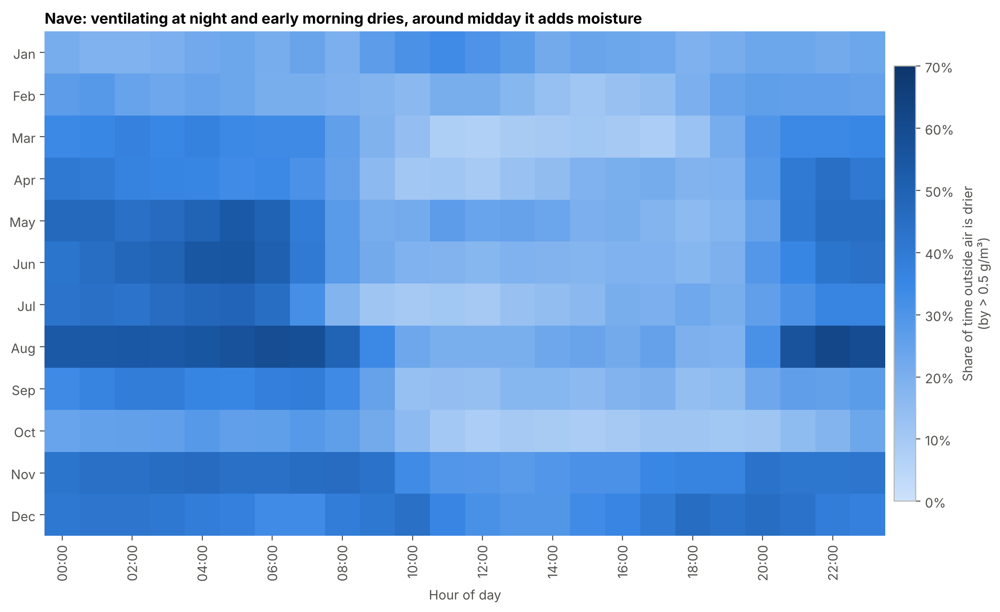{width=88%}

# 4 · The organ

Organs are sensitive to rapid temperature changes: they go out of tune and need more maintenance.
We counted every case in which the air temperature at the organ changed by **more than 1 °C within
one hour**.

* **{{organ_episodes}} occasions** ({{organ_events}} of the 20-minute measurements) between January 2024
  and November 2025: {{organ_episodes_by_season.2023/24}} in the heating season 2023/24 (from 19 January),
  {{organ_episodes_by_season.2024/25}} in 2024/25 and {{organ_episodes_by_season.2025/26}} so far in 2025/26.
* **All of them are warm-ups during the heating season**; there was none in summer and no case of too-fast
  cooling. During these warm-ups the walls of the church warmed about ten times faster than usual:
  the heating is switched on at full power.
* They happened mostly on **Fridays ({{organ_weekday_counts.Friday}}) and Saturdays ({{organ_weekday_counts.Saturday}})**,
  only {{organ_weekday_counts.Sunday}} times on a Sunday. Six Friday cases between January and March 2025 started at
  exactly 9:00–9:20 a.m. – a regular weekday event that is heated quickly. Christmas Eve 2024 caused
  one of the longest episodes.
* A typical heating start raises the organ temperature by about {{organ_warm_rise_median|f1}} °C within
  2–3 hours. Spreading the same warming over about 5 hours keeps it below the critical rate.
* The organ's surface warms more slowly and never exceeded the limit; the problem is the air around
  and in the pipes, which determines the pitch.

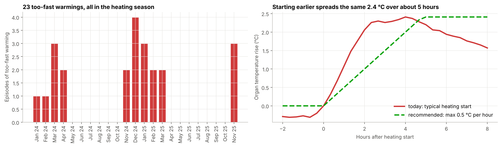{width=100%}

Many heating starts come close to the limit: with a limit of 0.8 °C instead of 1 °C per hour there
would have been {{organ_events_08}} occasions instead of {{organ_episodes}}. Small changes to the heating
schedule therefore make a big difference.

# 5 · Recommendations

Ordered by priority. Priority 1 measures are cheap and address the highest risks.

| Priority | What | Where | When | Why |
|-|-----------------------|---------|--------|----------|
| **1** | **Run a dehumidifier** (target below 70 % relative humidity) and **keep basement doors and hatches closed** during warm, humid days; store objects off the floor and at least 10 cm from the walls | Basement storage area | May – October | High risk {{share_high.Basement|pct}} of the time, {{season_share_high.summer.Basement|pct}} in summer, spells of up to {{longest_high_days.Basement|f1}} days |
| **1** | **Move art objects at least 10 cm away from the wall** (spacers), do not cover them, check their backs for mold | North-west corner and north-facing wall, lower level | now; inspection every September and November | Cold corner: high risk {{share_high.Art objects NW|pct}} of the time, often close to condensation |
| **1** | **Start the heating earlier and ramp gently**: at most 0.5 °C per hour at the organ, i.e. begin about 5 hours before an event; program *all* events, especially the regular Friday-morning and Saturday events | Whole church, organ | every heating start, October – April | {{organ_episodes}} too-fast warm-ups, all caused by heating starts |
| **1** | **Repair or replace the wall sensors** (north, south, east) and the humidity sensor of the north-west art objects; check the organ sensor (short glitches) | Walls, art objects, organ | before the next heating season | No wall data in winter 2024/25; north wall measured only {{availability.AWn|pct}} of the time |
| **2** | **Ventilate only when the outside air is drier than inside** (absolute humidity); in summer at night or early in the morning, never at midday. Ideally an automatic switch compares inside and outside humidity | Nave, basement | all year, especially May – September | Midday summer air adds moisture; outside air is drier only about a third of the time |
| **2** | **Gentle base heating in October and November** ("conservation heating"): keep the nave 1–2 °C warmer, raised slowly over several days, to bring the humidity below the mold limit; this also reduces the size of later heating jumps | Nave, organ | October – November | Whole nave critical in autumn; organ {{season_share_high.autumn.Organ|pct}} of the time |
| **2** | **Keep air moving** along the north wall: no furniture, curtains or stored items directly at the wall | North-facing exterior wall | permanently | Coldest wall, about three times as much high-risk time as the south wall |
| **3** | **Automatic alerts** (e-mail / SMS to the sexton): humidity above the mold limit for more than half of the last 7 days; surface less than 3 °C above the dew point; organ temperature rising by more than 0.8 °C in an hour; any sensor silent for more than 24 hours | All sensors | continuously | Turns this analysis into daily practice |
| **3** | **Add sensors**: surface temperature in the basement, attic and at the south art objects; a shaded radiation shield for the outside sensor; shade for the south art-object sensor near the window | Basement, attic, south wall, outside | next year | Sun distorts two sensors; three places have no surface measurement |
| **3** | **Visual mold inspection** of the red locations in late autumn, documented with photos | Basement, north-west corner, north wall, organ | every November | Confirms or corrects the risk index (there are no mold observations yet) |

# 6 · What the data cannot tell us

* **There are no mold observations.** The risk index is a cautious screening tool; it flags conditions in
  which mold *can* grow, not confirmed mold.
* **Large gaps**: the north wall was measured only in January–February 2024 and September–November 2025;
  the south and east walls not from late 2024 until September 2025; the north-west art objects lost
  their humidity sensor in April 2025. **No wall was measured in winter 2024/25.** We therefore compared
  places only over periods when both had data.
* **One sensor per place**: corners, the space behind objects and furniture can be colder and more humid
  than the sensor position.
* **The humidity limit was read from a published chart** and is approximate. Absolute percentages
  depend on it; the ranking of places does not.
* **Two sensors are affected by sun**: the outside sensor in the evening (up to {{au_max|f1}} °C) and the
  upper sensor at the south art objects near the window.
* **The outside humidity sensor saturates** in fog and rain ({{rh_over_100_AU|int}} readings above 100 %),
  which makes the outside humidity uncertain on such days.

# Technical appendix

## A · Data and sensor dictionary

Raw file `data/raw/ExampleChruchData_18-1-2024_29-11-2025.csv`: 49,032 rows × 44 columns, semicolon
separated, UTF-8, CRLF, decimal comma, missing code `-255`, 20-minute grid in UTC
(2024-01-18 23:00 – 2025-11-29 22:40 UTC). Columns `result` and `table` are technical and dropped. Column
pattern `<Measure>_<Sensor>`; measures: `Luft-Temperatur` → `temp` (°C), `Luft-Feuchtigkeit` → `rh` (%),
`Oberflächen-Temperatur` → `surf_temp` (°C), `Absolute-Luft-Feuchtigkeit` → `abs_hum` (g/m³), `Taupunkt` →
`dew_point` (°C). After cleaning: {{n_rows_clean|int}} rows, local time Europe/Berlin, {{start}} to {{end}}.

{{table:sensor_dictionary}}

Data availability (share of readings with a valid air temperature): outside {{availability.AU|pct}},
O1 {{availability.O1|pct}}, AWn {{availability.AWn|pct}}, AWs {{availability.AWs|pct}}, AWo {{availability.AWo|pct}},
K1 {{availability.K1|pct}}, K2 {{availability.K2|pct}}, D1 {{availability.D1|pct}}, Ke1 {{availability.Ke1|pct}}.

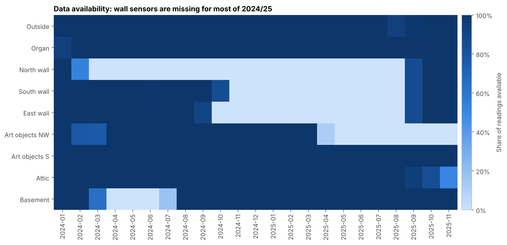{width=100%}

## B · Preprocessing (`src/load_data.py`, notebook 01)

Single command: `python -m src.load_data`. Every change is logged (`data/processed/preprocessing_log.csv`)
and, where relevant for later analysis, flagged in boolean columns (`flag_*`).

{{table:preprocessing_steps}}

Key decisions and evidence:

* **Decimal comma / missing code**: read with `decimal=","`; `-255` → NaN before any statistic; no other
  sentinel values (< −100) exist.
* **Time**: parsed as UTC, duplicate and grid checks in UTC (0 duplicates, every step exactly 20 min),
  converted to Europe/Berlin at the end (daily patterns follow local clock time; DST handled by tz-aware index).
* **Humidity > 100 %**: only outside, {{rh_over_100_AU|int}} readings (max {{rh_max_AU|f1}} %) and
  {{dp_over_t_AU|int}} readings with dew point > air temperature → clipped to 100 %, dew point = air
  temperature, absolute humidity recomputed at saturation, `flag_rh_clipped_AU`.
* **Magnus consistency**: recomputing absolute humidity and dew point from temperature and humidity
  reproduces the logger values within ±{{magnus_max_diff|f2}} (Magnus constants 17.62 / 243.12 °C) →
  derived quantities are recomputed after interpolation instead of being interpolated.
* **Installation day / relocation**: all sensors read 19–24 °C together until 13:40 on 19 Jan 2024 →
  rows removed; the organ air sensor read 3.5 °C above its own surface sensor overnight and dropped
  2.7 °C in 20 min at 08:40 on 20 Jan while the surface reading did not change → organ air values until
  then excluded ({{n_manual}} values).
* **Glitches**: {{n_spikes}} single readings at the organ where temperature (−1 to −2.5 °C) *and* humidity
  (≈ +10 %) jump and return at the next reading → NaN (`flag_spike_O1`). Each would otherwise create two
  false organ events.
* **Warm-up after outages**: first 2 h after a gap ≥ 6 h removed ({{n_warmup}} values).
* **Stuck sensors**: longest run of identical temperature/humidity values ≤ 5.7 h → nothing removed.
* **Sun on the outside sensor**: on {{au_max_evening_share|pct}} of days the outside maximum occurs between
  17 and 21 h (west tower, evening sun), maximum {{au_max|f1}} °C → {{sun_flag_n}} readings > 32 °C in the
  evening flagged (`flag_sun_AU`), kept, excluded from the lag analysis.
* **Interpolation**: linear in time, only for gaps of ≤ 3 readings (1 h), a gap is filled completely or not
  at all ({{n_interpolated|int}} values, flagged). Long gaps stay NaN.
* **Final assertions**: unique regular local index, no `-255`, 0 ≤ RH ≤ 100, dew point ≤ air temperature,
  all values within plausible ranges, boolean flags.

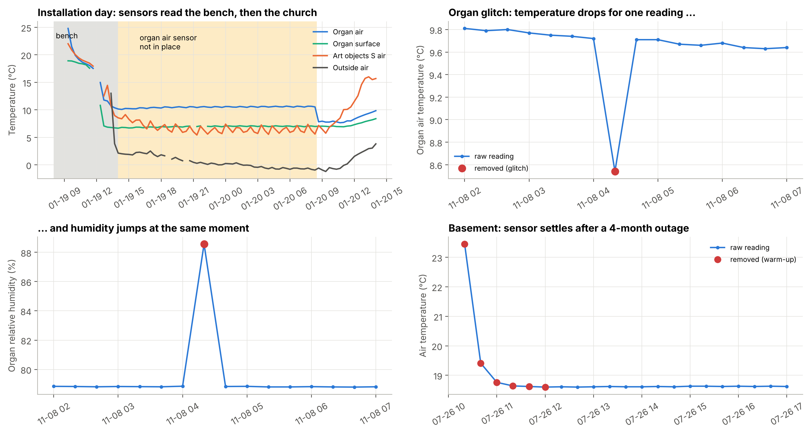{width=100%}

## C · Data quality and exploratory analysis (notebook 02)

**Gap lengths.** Of {{n_gaps|int}} gaps, {{share_gaps_le3|pct}} are at most 1 hour long, but they hold only
{{missing_in_short_gaps|pct1}} of all missing readings – missing data is dominated by a few outages of weeks
to months. Hold-out test (artificial gaps in complete data, mean absolute error of linear interpolation):

{{table:interp_holdout}}

Sensitivity of the headline results to the interpolation limit (0 = none, 2, 3, 6 readings):

{{table:interp_sensitivity|cols=limit,filled,organ_events,organ_episodes,high share Ke1,high share K1,high share AWn,high share O1}}

→ the 1-hour limit has negligible error (≈ {{holdout_organ_temp_3|f2}} °C at the organ) and no influence on
the results.

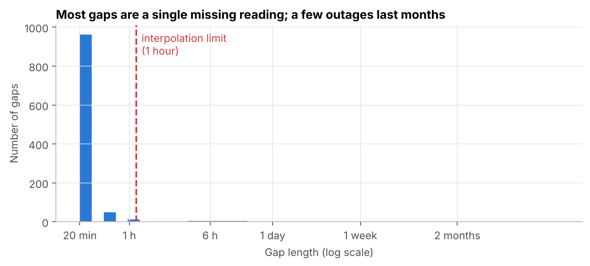{width=80%}

**Patterns.** Indoor daily cycles are small (organ ≈ 0.6 °C in the heating season) compared with outside;
the attic and the upper south art-object sensor (near the window, sun) are exceptions. Indoor absolute
humidity follows the outside closely (no strong internal moisture source).

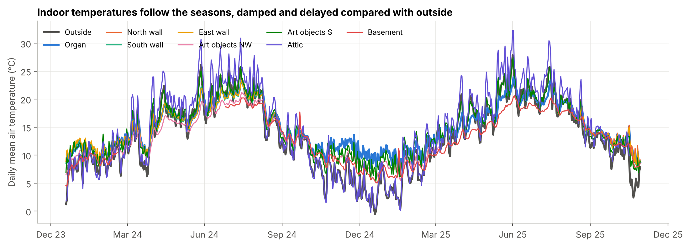{width=100%}

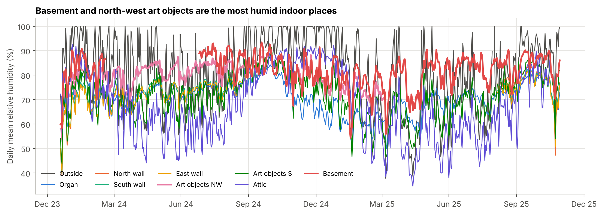{width=100%}

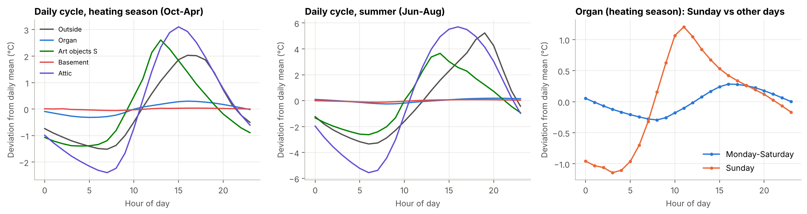{width=100%}

**Lagged correlation** (hourly data, daily cycle removed by a centred 24 h mean, season removed by a centred
7-day mean, lags 0–48 h). The nave responds to outside weather with a delay of about one day (organ
{{lag_organ_h}} h, basement {{lag_basement_h}} h), the attic within {{lag_attic_h}} h.

{{table:lag_correlation}}

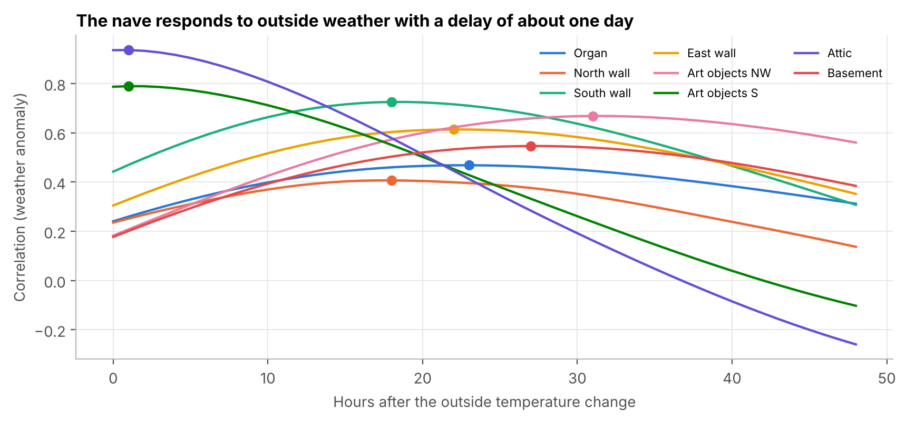{width=85%}

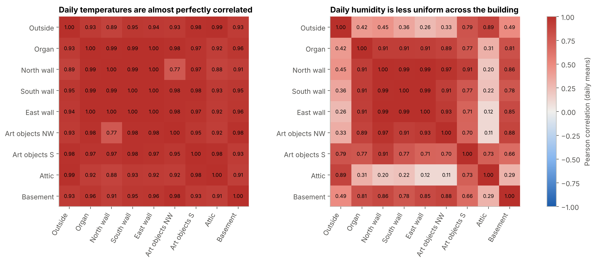{width=100%}

## D · Features and formulas (notebook 03, `src/features.py`, `src/physics.py`)

* Saturation vapour pressure (Magnus): $e_s(T) = 6.112\,\exp\!\left(\frac{17.62\,T}{243.12+T}\right)$ hPa;
  absolute humidity $= 216.7\, \frac{RH/100 \cdot e_s(T)}{273.15+T}$ g/m³.
* **Dew point margin** $= T_{surface} - T_{dew}$; levels ≤ 0 °C condensation, 0–3 °C critical, > 3 °C safer
  (2 and 4 °C as sensitivity).
* **Surface relative humidity** $RH_s = 100\, e_s(T_{dew}) / e_s(T_{surface})$ (capped at 100 %).
* **LIM threshold**: linear interpolation of points read from the Fraunhofer LIM_Bau chart; values outside
  0–30 °C held constant (conservative below 0 °C). Class I is the default.

| Temperature (°C) | 0 | 5 | 10 | 15 | 20 | 25 | 30 |
|---|---:|---:|---:|---:|---:|---:|---:|
| LIM class I (% RH) | 98 | 87 | 81.5 | 78.5 | 77 | 76 | 76 |
| LIM class II (% RH) | 100 | 90.5 | 85 | 82 | 80 | 79 | 79 |

* **LIM excess** = humidity − LIM(temperature), evaluated with surface humidity and surface temperature where a
  surface sensor exists (O1, AWn, AWs, AWo, K1), otherwise room air (K2, D1, Ke1).
* **Duration features**: per-reading flag 1/0/NaN (missing never safe); rolling critical hours and critical
  share of *valid* time over 24 h, 7 d, 30 d (NaN if < 50 % valid); cumulative exposure; episodes
  (missing data ends an episode).
* **Cross-sensor / time**: inside − outside temperature and absolute humidity, surface − air, hour, month,
  season, weekday, heating season (Oct–Apr).

{{table:dew_point_margin|pct=≤ 0 °C (condensation),0-2 °C,0-3 °C (critical),0-4 °C,> 3 °C (safer)}}

{{table:lim_shares|pct=above LIM I (surface basis),above LIM II (surface basis),above LIM I (room air basis)}}

{{table:surface_rh}}

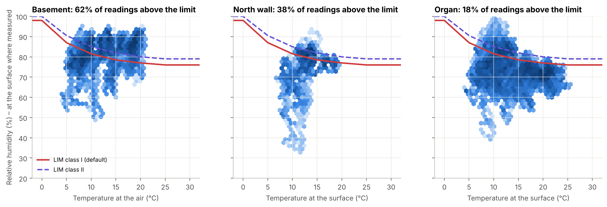{width=100%}

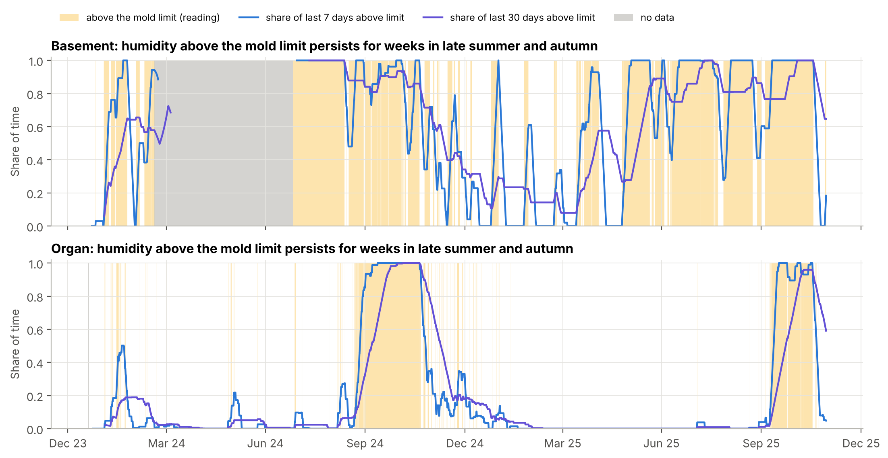{width=100%}

{{table:duration_features}}

## E · Risk rule, comparison and validation (notebook 04, `src/risk.py`)

**Rule.** high = dew point margin ≤ 0 °C, or LIM excess > 0 now and LIM share ≥ 50 % of the valid time in the
trailing 7 days; medium = LIM excess > 0 or 0 < margin ≤ 3 °C; low otherwise; NaN if inputs are missing.
Score = share high + 0.5 × share medium (shares of valid hours).

{{table:risk_summary_full|pct=coverage,share_high,share_medium,share_low}}

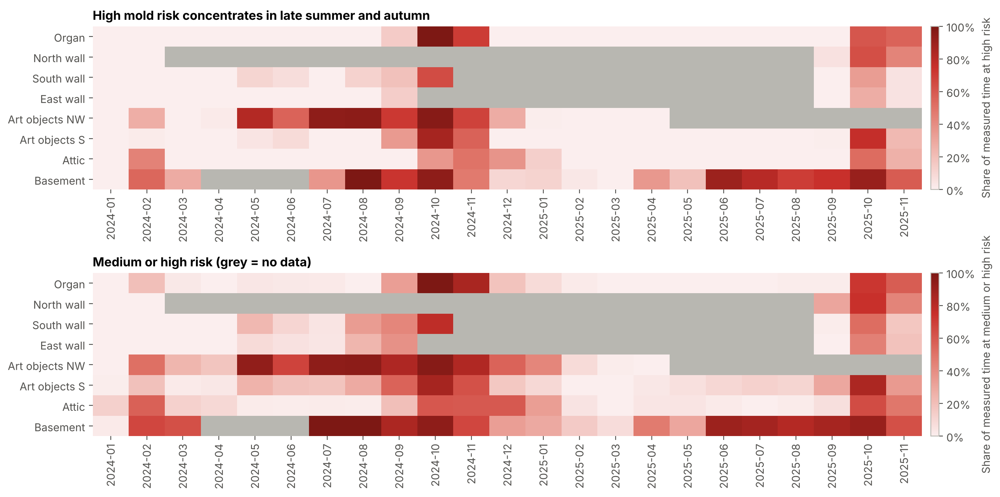{width=100%}

**Fair comparison.** Because sensor outages cover different seasons, each pair of locations is compared on
the readings where both have data (≥ 500 h); the Copeland count (wins − losses) gives the main ranking. Two
common windows with (almost) all locations: A = winter 2024 ({{winA_hours|int}} h, all 8), B = autumn 2025
({{winB_hours|int}} h, all except K1).

{{table:risk_ranking}}

{{table:risk_common_windows}}

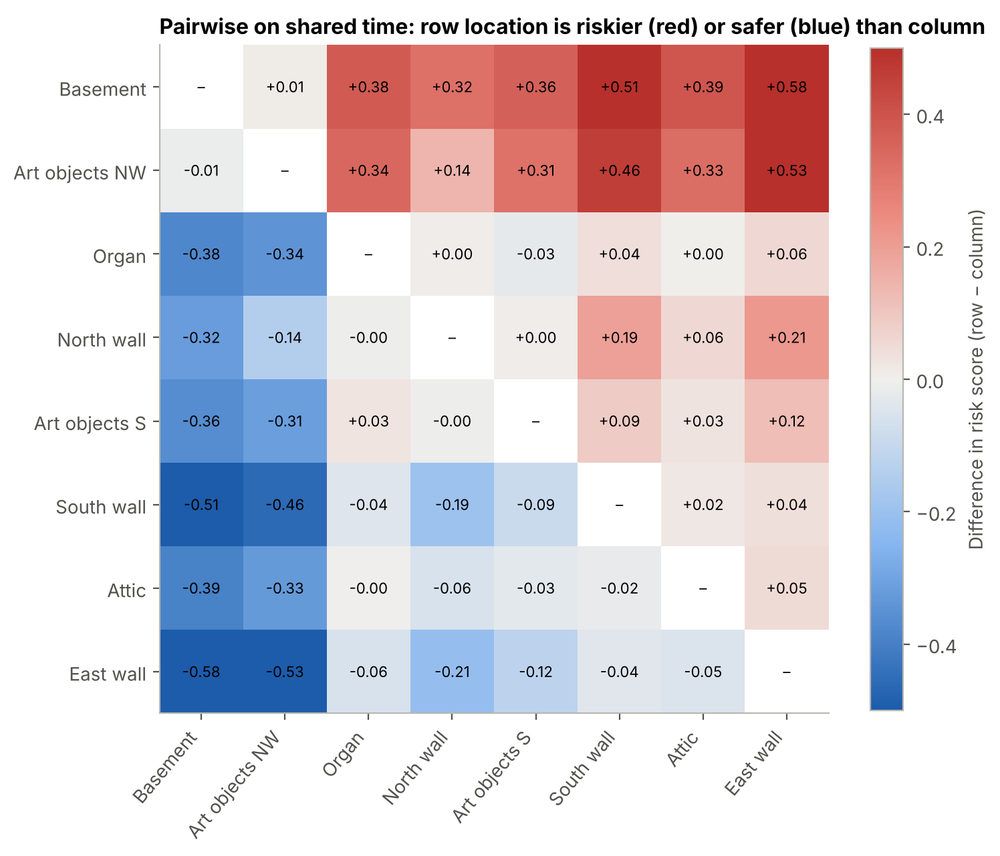{width=72%}

**Sensitivity** ({{n_configs}} configurations: LIM class I/II × margin 2/3/4 °C × persistence share 30/50/70 % ×
humidity basis surface/room air). Spearman correlation of the rankings with the default: min
{{sens_rho_min|f2}}, median {{sens_rho_median|f2}}.

{{table:sensitivity_summary|pct=share of configs in top 3}}

{{table:sensitivity_scores}}

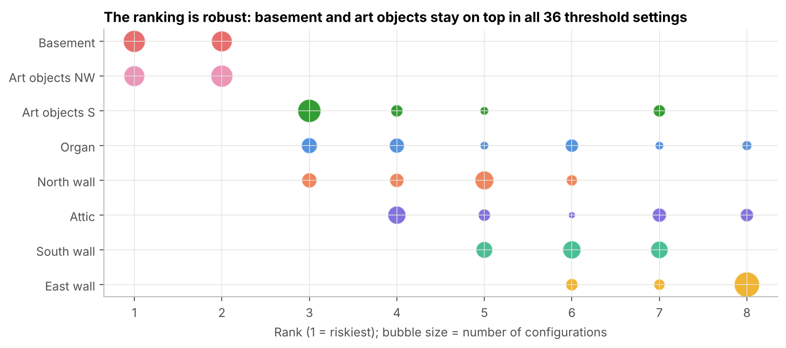{width=85%}

**Physical plausibility.** On identical readings the north wall's surface is colder relative to the air, has
a smaller dew point margin ({{plaus_north_margin|f2}} vs {{plaus_south_margin|f2}} °C) and more high-risk time
({{plaus_north_high|pct}} vs {{plaus_south_high|pct}}) than the south wall; basement and the cold north-west
corner peak in summer, the nave in autumn – as expected from building physics.

{{table:plausibility_walls}}

## F · Early-warning model (optional)

Target: any high-risk reading at the location in the next 24 h (not the current rule output, to avoid circular
validation). Inputs: outside temperature and absolute humidity (current, 24 h mean, 24 h change), indoor
temperature, humidity, LIM excess, critical share 24 h / 7 d, inside − outside absolute humidity, "high now",
month, heating season. Decision tree, depth 3, balanced class weights, min. 48 samples per leaf, seed 42.
Hourly samples; **time split** (train before 1 May 2025, last 24 h before the split purged; test May–Nov 2025;
sensitivity with 1 Mar and 1 Jul). Baselines: persistence (high now) and "above LIM now". Variant without rule
ingredients: only weather, indoor temperature/humidity and time.

F1 scores (split 1 May 2025); "onset hours" = hours that are not at high risk now:

{{table:model_f1}}

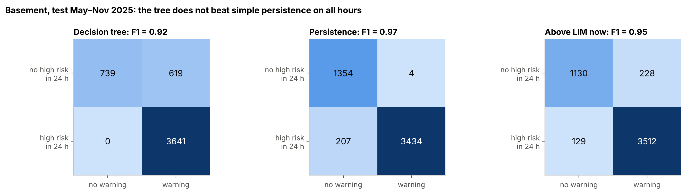{width=100%}

**Honest assessment.** On all hours the tree does not consistently beat persistence (better at K2, equal at
O1, worse at Ke1). It adds value on onset hours (recall 0.9–1.0) but with many false alarms (precision
0.25–0.58), and it does not warn at all for Ke1 with the 1 March split. Weather alone is a weak predictor at a
24 h horizon. Errors concentrate in transition months (September, November), not after fast weather changes.
The transparent rule is therefore recommended for operational alerts.

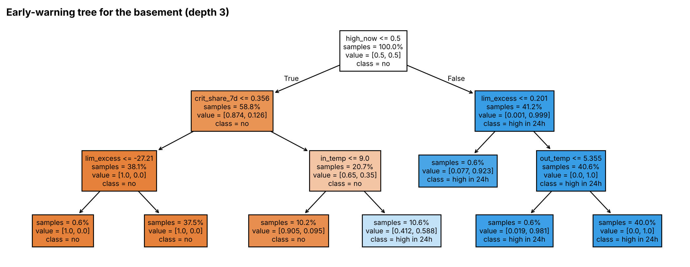{width=100%}

**Limitations of rule and model**: no mold ground truth; LIM read visually; only 17 % coverage for AWn and no
wall data in winter 2024/25; point sensors; room-air basis for K2, D1, Ke1 (no surface sensor) probably
underestimates their risk; after outages the 7-day persistence needs 3.5 days of data (affects ≤ 1 % of
readings above LIM); outside humidity sensor saturates; all high-risk test hours at O1 and K2 lie in autumn
2025.

## G · Organ analysis (notebook 05, `src/organ.py`)

Event: $|T(t_0) - T(t_0 + 1\,h)| > 1$ °C on `temp_O1`; the partner value is looked up **by timestamp**
(DST-safe, never across gaps). Episodes: events whose start times are ≤ 1 h apart (overlapping windows) are
merged; the stricter "consecutive readings" rule gives {{organ_episodes_consecutive}} episodes as well.

{{table:organ_robustness}}

On raw data {{organ_events_raw}} event readings / {{organ_episodes_raw}} episodes (row shift:
{{organ_events_naive}}, of which {{organ_naive_false}} bridge a data gap). Cleaning removes
{{organ_events_removed_by_cleaning.single-reading glitch}} event readings caused by glitches and
{{organ_events_removed_by_cleaning.installation / relocation}} from the installation day / relocation.
Final: {{organ_events}} event readings, {{organ_episodes}} episodes, {{organ_warming_episodes}} warming,
{{organ_cooling_events}} cooling.

{{table:organ_by_season}}

{{table:organ_threshold_sensitivity}}

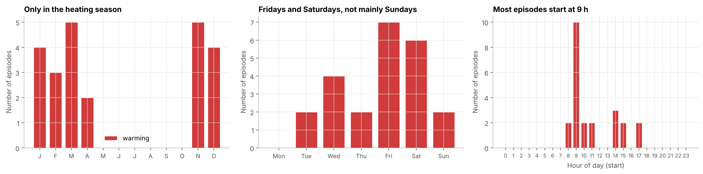{width=100%}

{{table:organ_context}}

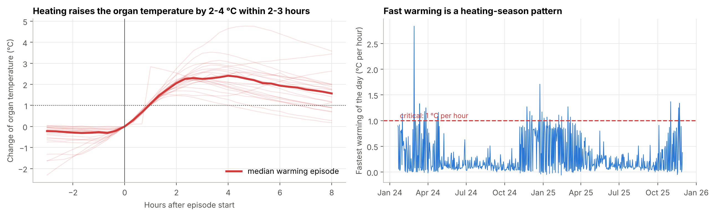{width=100%}

## H · Reproducibility

* Repository layout: `data/raw` (never modified), `data/processed` (generated), `src` (all logic),
  `notebook` (01–06, executed; `notebook/py` holds the paired plain-text sources), `report`.
* One command: `python -m src.run_all` (preprocessing, all notebooks top to bottom, this PDF). Python 3.13,
  versions in `requirements.txt`; fixed random seed 42; PDF via pandoc and headless Chromium.
* Numbers in this report are inserted automatically from `report/tables/` (written by the notebooks), so
  text and code cannot diverge.
